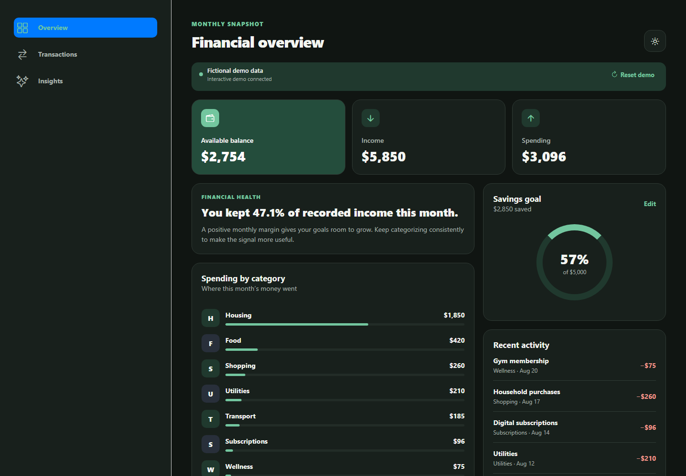
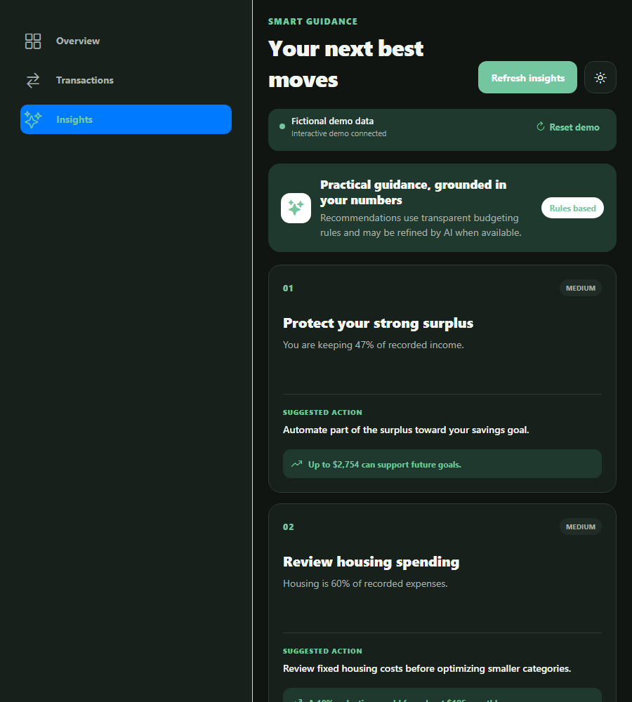
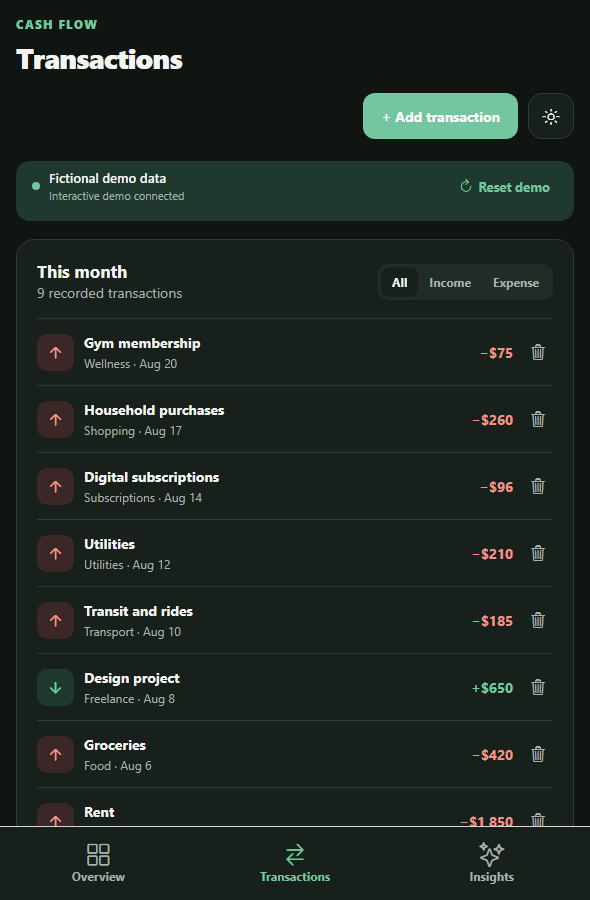

# Budget Buddy

Budget Buddy is a responsive expense-tracking demo that turns a fictional monthly snapshot into practical guidance. It was rebuilt from an early student prototype into a deliberately scoped portfolio project: no bank credentials, fake production authentication, or AI dependency that can break the core experience.

[Open the live demo](https://expense-tracker.toeneeoh.workers.dev) · [API health](https://budget-buddy-api-c24j.onrender.com/api/health)

## Preview



| Responsive insights | Narrow transaction view |
| --- | --- |
|  |  |

## What reviewers can do

- Understand income, spending, monthly balance, category mix, and savings progress.
- Add or remove transactions and immediately see derived values update.
- Change a savings goal or restore the fictional seed scenario with one click.
- Generate three educational recommendations. Budgeting rules always work; OpenAI can optionally refine the language.
- Use the same experience on desktop and narrow mobile screens.
- Start in dark mode and persist a manual light/dark preference.

## Architecture

The frontend uses Expo, React Native Web, Expo Router, and TypeScript. One finance provider owns request state and exposes typed actions to three screens.

The Flask API exposes only anonymous demo-session operations. SQLite is the zero-configuration local database; a PostgreSQL `DATABASE_URL` can be supplied for hosting. Session IDs isolate reviewers without collecting identity or password data.

```text
Expo web app → validated Flask API → SQLite / PostgreSQL
                       ↓
              rule-based insights
                       ↓ optional
                 OpenAI rewrite
```

Repository layout:

```text
frontend/   Expo, React Native Web, and TypeScript
backend/    Flask API, persistence, and API tests
package.json  Root commands used locally, in CI, and by hosting
```

## Local setup

Requirements: a current Node.js LTS release and Python 3.11+.

```bash
cp .env.example .env
python -m venv .venv
# Activate .venv for your shell
pip install -r backend/requirements.txt
npm install
```

Run the API and web app in separate terminals:

```bash
npm run start:api
npm run web
```

Defaults use `http://localhost:5000` and a local `budget_buddy.db`. Set `EXPO_PUBLIC_API_URL`, `DATABASE_URL`, and `FRONTEND_ORIGINS` for hosting.

`OPENAI_API_KEY` and `OPENAI_MODEL` are optional. Without them—or if the model fails—the API returns deterministic insights and identifies the source as `rules`.

## Quality checks

```bash
npm run lint
npm run typecheck
npm test
npm run test:api
npm run build:web
npm audit --omit=dev
pip-audit -r backend/requirements.txt
```

CI runs type checking, frontend and backend tests, a static web export, and production dependency audits.

For the intentionally free Cloudflare Workers Static Assets + Render deployment, see [DEPLOYMENT.md](DEPLOYMENT.md). The overview renders from a bundled snapshot while a sleeping free API wakes; editing activates when the service connects.

The current npm audit reports moderate `uuid` findings through Expo's native Xcode build tooling. They are not used in the hosted browser runtime, no compatible upstream fix is available, and npm's proposed forced fix downgrades Expo to an unsupported release. CI fails on high or critical production findings while this upstream advisory is monitored. The pinned Python set currently audits cleanly.

## API

The API provides session creation, dashboard reads, transaction creation/deletion, goal updates, demo reset, insight generation, and a health check under `/api`. Errors use `{ "error": { "code": "...", "message": "..." } }`. Request bodies are size-limited, CORS origins are explicit, and AI refreshes are rate-limited.

## Intentional boundaries

This is a portfolio demonstration, not a financial product. It does not connect to banks, store personal profiles, support real accounts, or provide professional financial advice. All demo records are fictional and resettable.

## Rebuild story

The original project mixed incomplete onboarding, plaintext demo passwords, generic database mutation endpoints, hardcoded infrastructure, and brittle LLM parsing. Version 2 concentrates the product around one credible reviewer journey: inspect the seeded picture, make a change, observe consistent calculations, and get resilient guidance.
